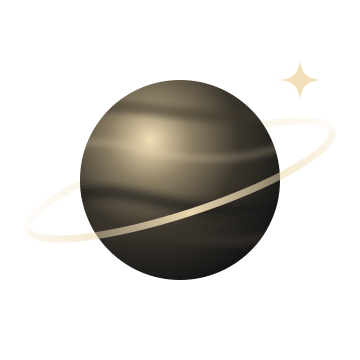

  
  

<b>Oi! Eu sou a Jordana 👋</b>

 

<table>
<tr>
<td width="65%" valign="top">

**Desenvolvedora Fullstack e estudante de Análise e Desenvolvimento de Sistemas (UNAMA)**

Sou graduada em Tecnologia da Informação e estou no 4º período de ADS. Gosto de transformar dados e ideias em soluções digitais.

Desenvolvo projetos fullstack para web e mobile e estudo análise de dados e banco de dados, áreas em que quero me aprofundar com uma pós-graduação.

Nas horas vagas, trabalho com design de eventos.

</td>
<td width="35%" align="center" valign="middle">

</td>
</tr>
</table>

 

<picture>
  <source media="(prefers-color-scheme: dark)" srcset="https://raw.githubusercontent.com/whoolv/whoolv/output/cobrinha-escura.svg" />
  <source media="(prefers-color-scheme: light)" srcset="https://raw.githubusercontent.com/whoolv/whoolv/output/cobrinha-clara.svg" />
  
</picture>
